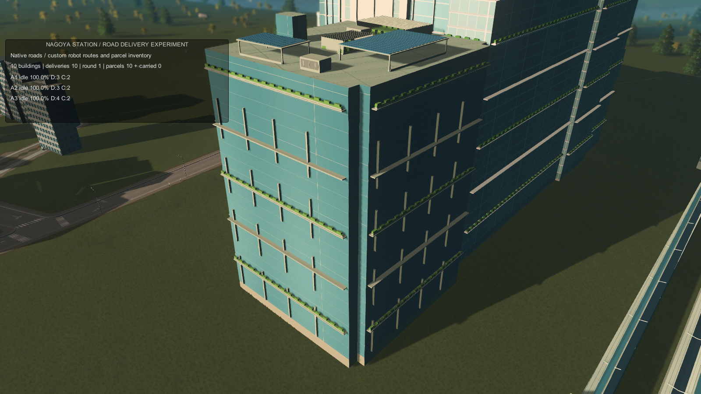

# Nagoya 2050 visual experiment

This case study records a PLATEAU-based Nagoya Station prototype in Cities: Skylines 1. The selected ten buildings keep their measured shapes and relative positions, with authored 2050 facade and rooftop retrofits. Corresponding source photographs were not locally available for these ten buildings; the new exteriors are inferred designs.

The current record contains individual game screenshots for 2 of the ten selected buildings and 6 screenshots in total. The last recorded runtime scene contains 40 models. These counts describe the saved evidence, rather than a live game feed.

[Japanese illustrated record](../ja/guide/nagoya-2050-visuals.md)

Production uses [Blender Skills](https://github.com/arjun988/blender-skills), pinned to `904f095d8f36a6e72adaebb08d07f884a074743d`, for direction, environment art, hard surface modeling, UVs, materials, textures, look development, optimization, export, Unity integration and QA.

The models are runtime scenery rather than native BuildingInfo assets. Courier inventory, battery and routing are a separate experimental mod; prototype pedestrians are excluded from normal housing and employment transfers. This is not a completed Nagoya district or a verification of long-term operation and access roads to every new building.

Shape source: PLATEAU Nagoya 2022, tile 52366700. Game captures: Cities: Skylines 1. Added exteriors and equipment: authored for this experiment. Images are unedited original screenshots, with [SHA-256 evidence](../assets/nagoya-2050/2026-11-17/evidence.json).
