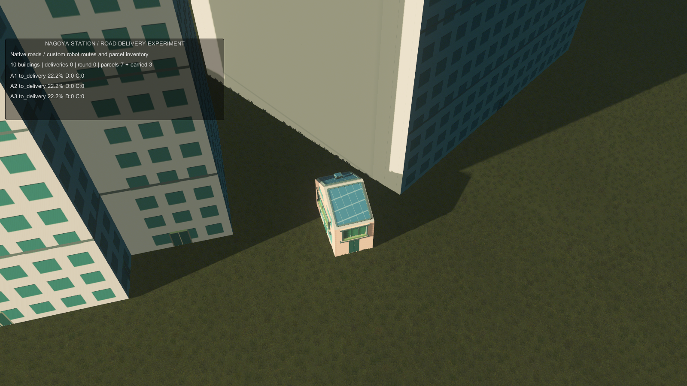
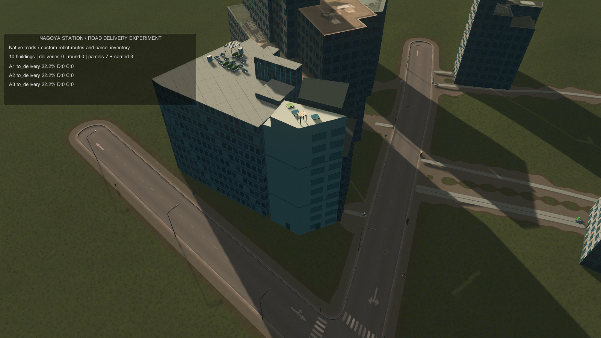
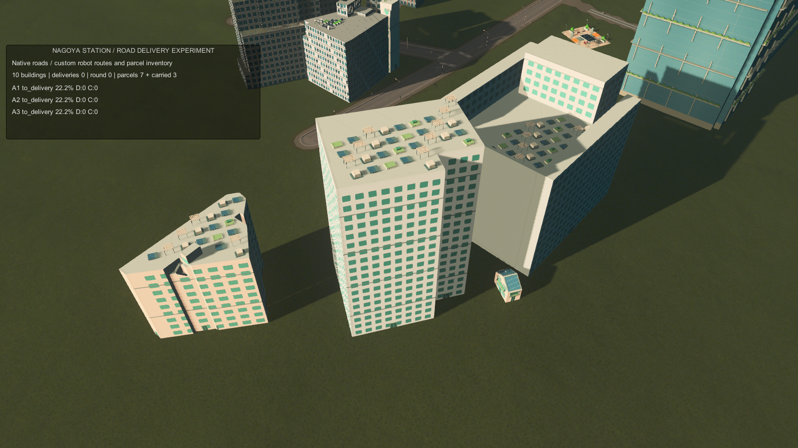
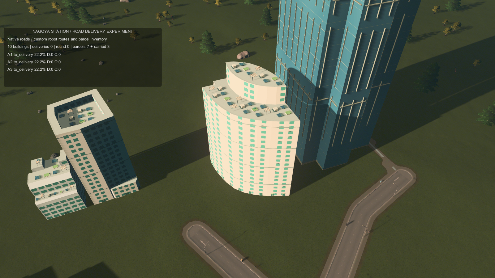
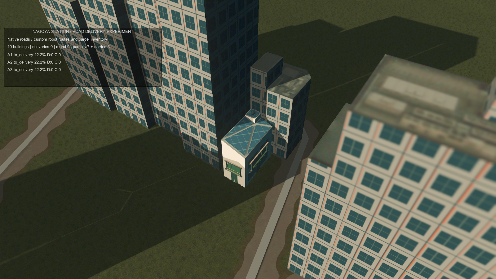
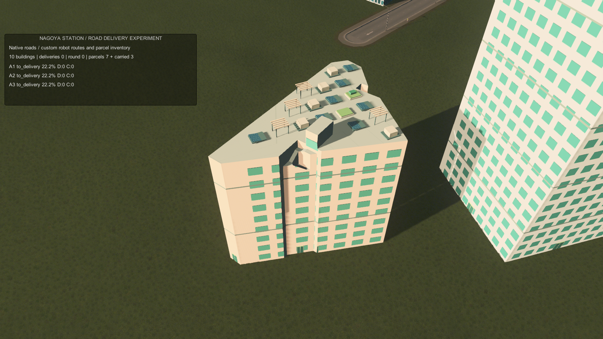
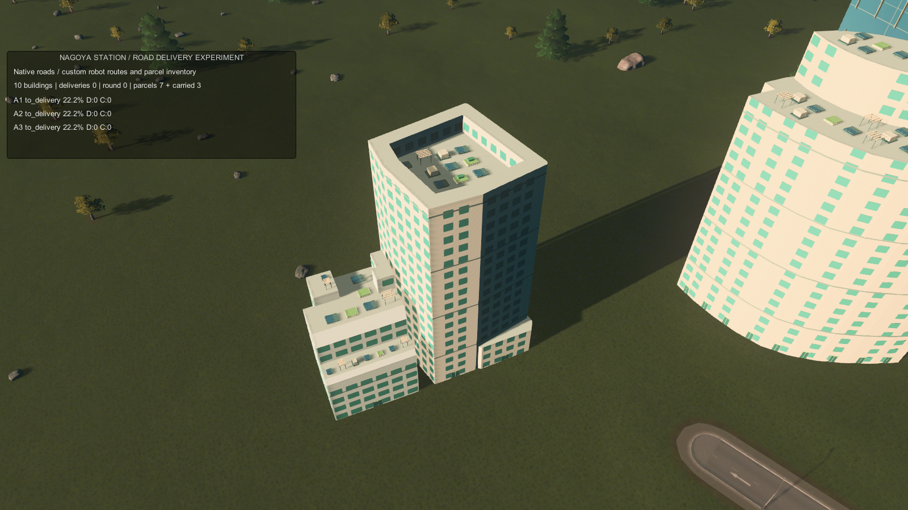
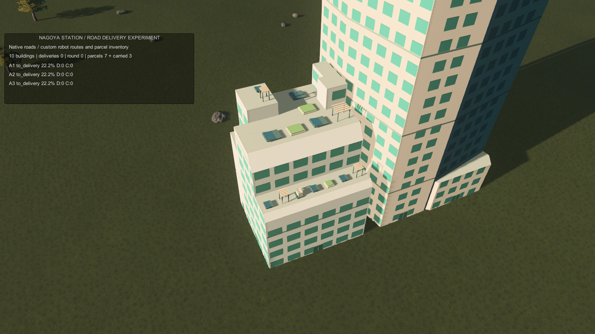
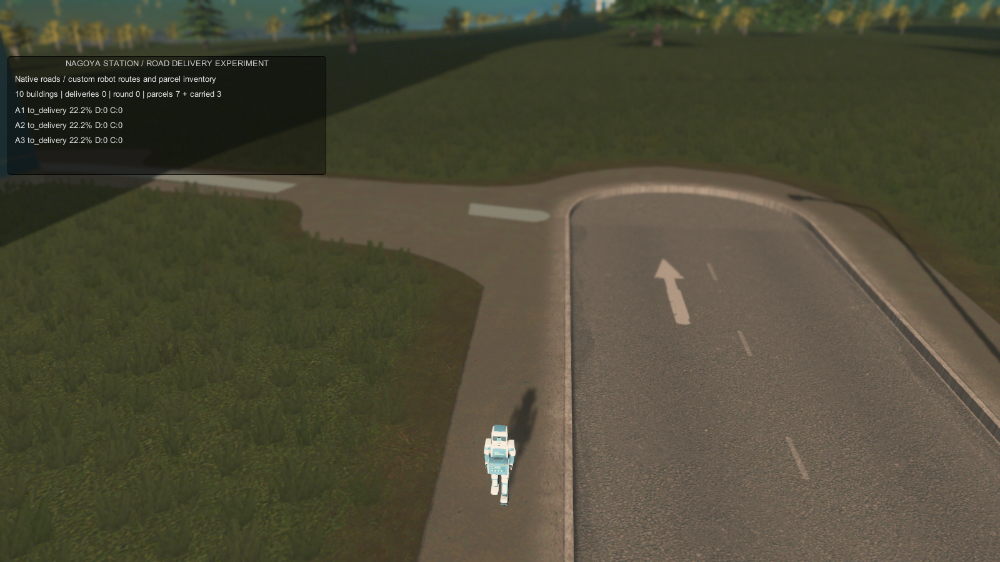
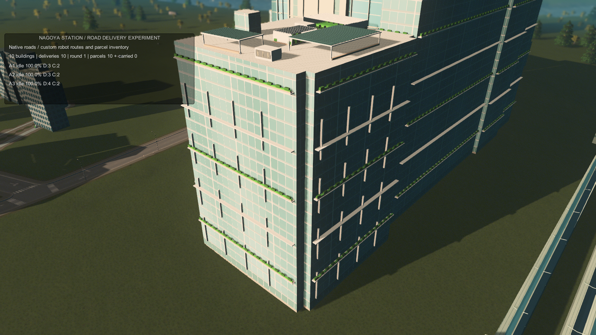

# 名古屋駅2050 — 10棟整備と実ゲーム画像

2026年11月17日。Blender Skills を用いた建物・アンドロイド・街区の整備記録です。画像はCS1の実スクリーンショットで、生成画像やBlenderレンダーとは区別しています。

直近のゲーム記録：建物42棟、広場などの創作オブジェクト2件。

広場2か所は配置済みですが、草が舗装を貫通する問題を修正中です。外観の合格画像にはまだ含めていません。

| 番号 | PLATEAU建物ID | 元の高さ | 状態 |
|---|---|---:|---|
| 01 | `bldg_d1a837ed-fad7-43c7-94c5-f51820402a90` | 6.00 m | CS1表示・スクショ保存済み |
| 02 | `bldg_63357b46-b465-4801-b6be-3b2606f9b7fb` | 59.37 m | CS1表示・スクショ保存済み |
| 03 | `bldg_f89ef351-3857-45b6-abdc-7b3dc8f66c8c` | 8.81 m | CS1表示・スクショ保存済み |
| 04 | `bldg_bd0623e1-7cb3-458b-95b6-6a6953e58b39` | 38.18 m | CS1表示・スクショ保存済み |
| 05 | `bldg_ebb3502f-89a2-4fcd-b652-eb757e6b1213` | 66.82 m | CS1表示・スクショ保存済み |
| 06 | `bldg_18971f17-fb89-486f-8a11-969af0720c52` | 75.38 m | CS1表示・スクショ保存済み |
| 07 | `bldg_f00ea62c-0de5-4d16-a2a0-5d4e957ae395` | 10.67 m | CS1表示・スクショ保存済み |
| 08 | `bldg_eddf3b01-3881-417c-a348-58b796bd75fe` | 37.12 m | CS1表示・スクショ保存済み |
| 09 | `bldg_51afdba6-916f-47e2-8280-96b8990bbc30` | 62.28 m | CS1表示・スクショ保存済み |
| 10 | `bldg_e755b566-7f32-42a1-8c9f-922b6a63c543` | 32.72 m | CS1表示・スクショ保存済み |

## 建物01 — bldg_d1a837ed-fad7-43c7-94c5-f51820402a90

中央の低層複合施設が対象です。PLATEAU実測形状を保った創作の2050年外装で、元写真の復元ではありません。

## 建物02 — bldg_63357b46-b465-4801-b6be-3b2606f9b7fb

中央のコ字型の建物が対象です。PLATEAU実測形状を保った創作の2050年外装で、元写真の復元ではありません。

## 建物03 — bldg_f89ef351-3857-45b6-abdc-7b3dc8f66c8c

中央の小さな切妻建物が対象です。PLATEAU実測形状を保った創作の2050年外装で、元写真の復元ではありません。

## 建物04 — bldg_bd0623e1-7cb3-458b-95b6-6a6953e58b39

手前中央の細い三角形のビルが対象です。PLATEAU実測形状を保った創作の2050年外装で、元写真の復元ではありません。

## 建物05 — bldg_ebb3502f-89a2-4fcd-b652-eb757e6b1213

中央の箱形の高層棟が対象です。PLATEAU実測形状を保った創作の2050年外装で、元写真の復元ではありません。

## 建物06 — bldg_18971f17-fb89-486f-8a11-969af0720c52

中央の丸みのある複合ビルが対象です。PLATEAU実測形状を保った創作の2050年外装で、元写真の復元ではありません。

## 建物07 — bldg_f00ea62c-0de5-4d16-a2a0-5d4e957ae395

中央の小さな斜め屋根の建物が対象です。PLATEAU実測形状を保った創作の2050年外装で、元写真の復元ではありません。

## 建物08 — bldg_eddf3b01-3881-417c-a348-58b796bd75fe

中央の折れ曲がった立面の建物が対象です。PLATEAU実測形状を保った創作の2050年外装で、元写真の復元ではありません。

## 建物09 — bldg_51afdba6-916f-47e2-8280-96b8990bbc30

中央の高層棟が対象です。PLATEAU実測形状を保った創作の2050年外装で、元写真の復元ではありません。

## 建物10 — bldg_e755b566-7f32-42a1-8c9f-922b6a63c543

手前の段状の建物（背景の高層棟は別棟）が対象です。PLATEAU実測形状を保った創作の2050年外装で、元写真の復元ではありません。

## アンドロイド配送中

配送途中で一時停止し、ケースを持った姿を撮影。全身と足元に遮蔽はありません。ゲーム内カメラの最短距離制限により、個体は画面内で約128pxの高さです。

## 主要建物の修正前（front）

同じカメラ条件の実ゲーム比較。

## 主要建物の修正後（front）

形状・配置を保ち、強過ぎた白い格子と屋根の材質を整理。日除け・PV・植栽を表示。

## 主要建物の修正前（roof）

同じカメラ条件の実ゲーム比較。

## 主要建物の修正後（roof）

形状・配置を保ち、強過ぎた白い格子と屋根の材質を整理。日除け・PV・植栽を表示。

## 制作方法と確認範囲

- 形状出典：PLATEAU 名古屋市2022、52366700。元の配置・本体形状を保ち、屋根と壁のUV・材質を分離。
- 2050年外装：日除け、太陽光設備、緑化、金属・ガラスの外装は創作。今回の新10棟に対応する元写真はローカルにありません。
- 使用：[arjun988/blender-skills](https://github.com/arjun988/blender-skills)、commit `904f095d8f36a6e72adaebb08d07f884a074743d`。director、environment、hard-surface、UV、materials、texture、lookdev、optimization、export、Unity、QAを担当別に適用。
- 建物は実行時に読み込む独自メッシュで、通常のBuildingInfoや都市経済には未接続。アンドロイドの配送・電池・在庫は独自MODです。人間は試験用cohortで、通常の住宅・就労経済から除外しています。
- 名古屋駅周辺全体の完成、長時間安定運転、全棟の道路接続を意味しません。

- スクショのHUDにある配送対象10棟は元の配送実験の対象で、今回追加した外観検証用10棟とは異なります。

[画像のSHA-256と対象ID](../../assets/nagoya-2050/2026-11-17/evidence.json)
