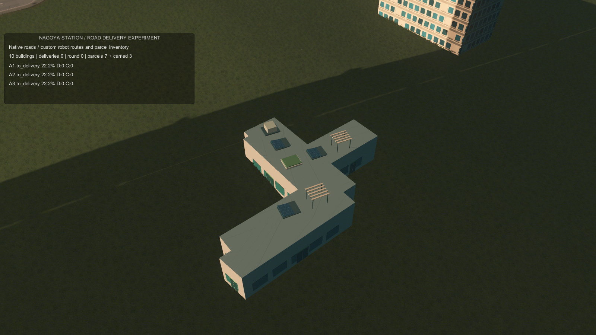
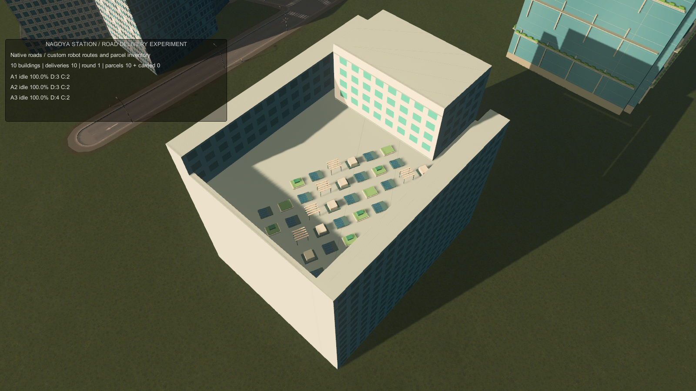
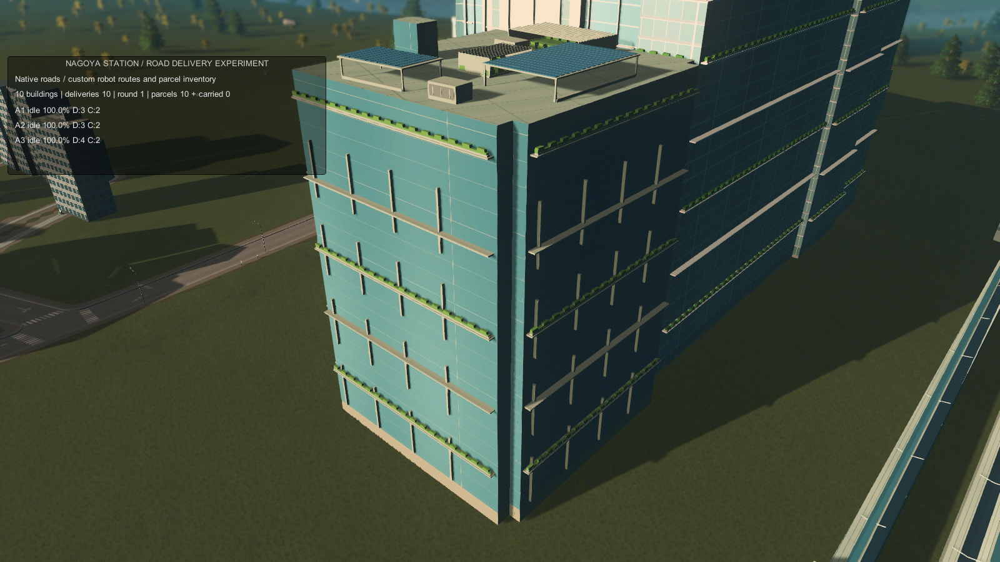
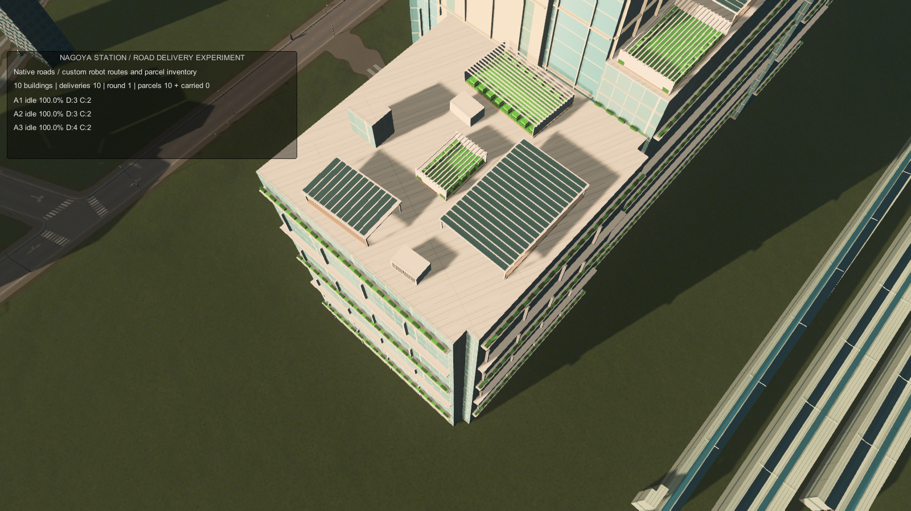
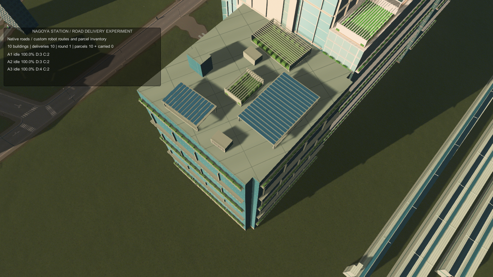

# 名古屋駅2050 — 10棟整備と実ゲーム画像

2026年11月17日。Blender Skills を用いた建物・アンドロイド・街区の整備記録です。画像はCS1の実スクリーンショットで、生成画像やBlenderレンダーとは区別しています。

| 番号 | PLATEAU建物ID | 元の高さ | 状態 |
|---|---|---:|---|
| 01 | `bldg_d1a837ed-fad7-43c7-94c5-f51820402a90` | 6.00 m | CS1表示・スクショ保存済み |
| 02 | `bldg_63357b46-b465-4801-b6be-3b2606f9b7fb` | 59.37 m | CS1表示・スクショ保存済み |
| 03 | `bldg_f89ef351-3857-45b6-abdc-7b3dc8f66c8c` | 8.81 m | 制作・CS1確認中 |
| 04 | `bldg_bd0623e1-7cb3-458b-95b6-6a6953e58b39` | 38.18 m | 制作・CS1確認中 |
| 05 | `bldg_ebb3502f-89a2-4fcd-b652-eb757e6b1213` | 66.82 m | 制作・CS1確認中 |
| 06 | `bldg_18971f17-fb89-486f-8a11-969af0720c52` | 75.38 m | 制作・CS1確認中 |
| 07 | `bldg_f00ea62c-0de5-4d16-a2a0-5d4e957ae395` | 10.67 m | 制作・CS1確認中 |
| 08 | `bldg_eddf3b01-3881-417c-a348-58b796bd75fe` | 37.12 m | 制作・CS1確認中 |
| 09 | `bldg_51afdba6-916f-47e2-8280-96b8990bbc30` | 62.28 m | 制作・CS1確認中 |
| 10 | `bldg_e755b566-7f32-42a1-8c9f-922b6a63c543` | 32.72 m | 制作・CS1確認中 |

## 建物01 — bldg_d1a837ed-fad7-43c7-94c5-f51820402a90

PLATEAU実測形状を保った創作の2050年外装。元写真の復元ではありません。

## 建物02 — bldg_63357b46-b465-4801-b6be-3b2606f9b7fb

PLATEAU実測形状を保った創作の2050年外装。元写真の復元ではありません。

## 主要建物の修正前（front）

同じカメラ条件の実ゲーム比較。

## 主要建物の修正後（front）

形状・配置を保ち、強過ぎた白い格子と屋根の材質を整理。日除け・PV・植栽を表示。

## 主要建物の修正前（roof）

同じカメラ条件の実ゲーム比較。

## 主要建物の修正後（roof）

形状・配置を保ち、強過ぎた白い格子と屋根の材質を整理。日除け・PV・植栽を表示。

## 制作方法と確認範囲

- 形状出典：PLATEAU 名古屋市2022、52366700。元の配置・本体形状を保ち、屋根と壁のUV・材質を分離。
- 2050年外装：日除け、太陽光設備、緑化、金属・ガラスの外装は創作。今回の新10棟に対応する元写真はローカルにありません。
- 使用：[arjun988/blender-skills](https://github.com/arjun988/blender-skills)、commit `904f095d8f36a6e72adaebb08d07f884a074743d`。director、environment、hard-surface、UV、materials、texture、lookdev、optimization、export、Unity、QAを担当別に適用。
- 建物は実行時に読み込む独自メッシュで、通常のBuildingInfoや都市経済には未接続。アンドロイドの配送・電池・在庫は独自MODです。人間は試験用cohortで、通常の住宅・就労経済から除外しています。
- 名古屋駅周辺全体の完成、長時間安定運転、全棟の道路接続を意味しません。

[画像のSHA-256と対象ID](../../assets/nagoya-2050/2026-11-17/evidence.json)
